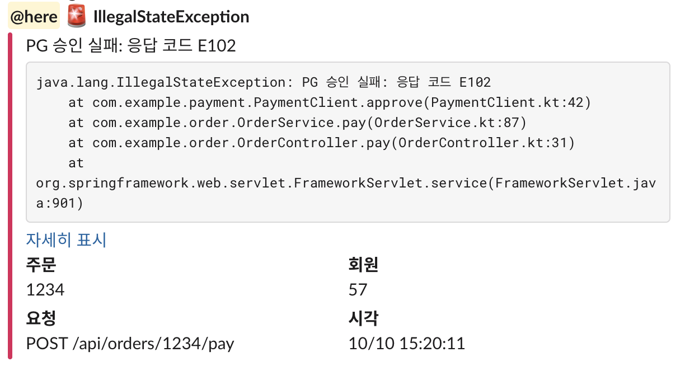

# whistle-notifier

Kotlin/Spring Boot 백엔드용 Slack 알림 라이브러리.

- 외부 의존성 없이 JDK `HttpClient`로 Slack Incoming Webhook 전송
- 레벨별 색상 바, 키-값 필드, 예외 stacktrace 지원

## Requirements

- Java 17+
- Spring Boot 3.x (스타터 사용 시)

## Installation

### Spring Boot

```kotlin
dependencies {
    implementation("io.github.junrock:whistle-spring-boot-starter:0.0.2")
}
```

```xml
<dependency>
    <groupId>io.github.junrock</groupId>
    <artifactId>whistle-spring-boot-starter</artifactId>
    <version>0.0.2</version>
</dependency>
```

### Spring 없이 (순수 Kotlin/Java)

```kotlin
dependencies {
    implementation("io.github.junrock:whistle-slack:0.0.2")
}
```

```xml
<dependency>
    <groupId>io.github.junrock</groupId>
    <artifactId>whistle-slack</artifactId>
    <version>0.0.2</version>
</dependency>
```

## Quick Start (Spring Boot)

**1. Slack 웹훅 URL 발급**

Slack 앱 설정 → Incoming Webhooks → 채널 선택 후 URL 복사

**2. 설정**

```yaml
whistle:
  slack:
    webhook-url: ${SLACK_WEBHOOK_URL}
```

**3. 사용**

```kotlin
import io.junseok.whistle.Whistle
import io.junseok.whistle.slack.slack

@Service
class OrderService(private val whistle: Whistle) {
    fun pay(orderId: Long) {
        whistle.slack("결제 실패", "orderId=$orderId")
    }
}
```

## Configuration

| 속성 | 기본값 | 설명 |
|---|---|---|
| `whistle.slack.webhook-url` | - | Slack Incoming Webhook URL. 없으면 Slack 채널 미등록 |
| `whistle.slack.timeout` | `3s` | 요청 타임아웃 |

## Usage

### 기본

```kotlin
whistle.slack("배치 완료", "처리 1,204건", level = Level.INFO)
```

| Level | 표시 |
|---|---|
| `INFO` | ℹ️ 파란 바 |
| `WARN` | ⚠️ 노란 바 |
| `ERROR` (기본값) | 🚨 빨간 바 |
| `SUCCESS` | ✅ 초록 바 |

### 멘션

```kotlin
whistle.slack("서버 다운", "api-1 응답 없음", mentions = listOf(Mention.Here))
```

| 값 | 결과 |
|---|---|
| `Mention.Here` | `@here` |
| `Mention.Channel` | `@channel` |
| `Mention.User("U01ABCDEF")` | 특정 사용자 (Slack 멤버 ID, 이름 불가) |

### 필드와 링크

```kotlin
whistle.slack(
    title = "결제 실패",
    body = "PG 응답 코드 E102",
    fields = mapOf("주문" to "1234", "회원" to "57", "금액" to "12,000원"),
    link = "https://admin.example.com/orders/1234",
)
```

필드는 2열로, 넣은 순서대로 표시.

### 예외 알림

`exception`을 넘기면 본문 아래에 stacktrace가 코드 블록으로 붙음.

```kotlin
try {
    paymentClient.approve(orderId)
} catch (e: Exception) {
    whistle.slack(
        title = e.javaClass.simpleName,
        body = e.message ?: "",
        mentions = listOf(Mention.Here),
        fields = mapOf("주문" to "$orderId"),
        exception = e,
    )
    throw e
}
```



긴 stacktrace는 앞 20줄만 전송되고, Slack에서 "자세히 표시"로 펼쳐 볼 수 있음.


### Spring 없이

```kotlin
val whistle = Whistle(listOf(Slack(System.getenv("SLACK_WEBHOOK_URL"))))

whistle.slack("배치 완료", "처리 1,204건")
```

타임아웃 변경: `Slack(url, Duration.ofSeconds(5))`

## License

[MIT](LICENSE)
